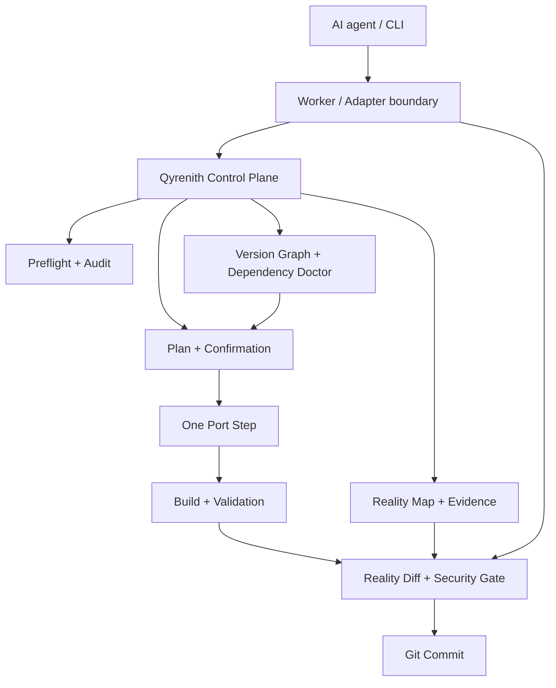

# Qyrenith

**Deterministic verification, safety, and orchestration for Non-AI and AI-assisted software development.**

Minecraft is the first flagship domain. Qyrenith is designed to extend to game modding and ordinary software projects through domain adapters, providers, workers, and language/build integrations.

Qyrenith is a local, standard-library-only Python control plane and orchestration layer. It does not replace Minecraft knowledge, a build system, or an AI model. Instead, it controls the boundaries around them.

## Why it exists

AI agents are good at editing code, but an agent saying *"done"* is not evidence that a migration is safe. Qyrenith creates an auditable workflow:

```text
AUDIT → BACKUP → REALITY MAP → PLAN → ONE STEP → AGENT → BUILD → VALIDATE → DIFF → COMMIT
```

The agent supplies domain expertise. Qyrenith supplies deterministic gates.

## Domain scope

The core is project-neutral. The current domain registry covers:

- Minecraft
- Roblox
- Skyrim
- GTA/FiveM
- Unity
- Godot
- Unreal Engine
- Python
- JavaScript/TypeScript/Node
- Java
- Rust
- C/C++

Registry presence means safe routing and extension support, not full domain maturity. A domain is considered fully supported only after real validators, providers, workers, and benchmarks exist.

For example, a Minecraft repository containing a Python utility can be handled as a generic/Python task; the Minecraft migration skill is not selected merely because the repository is a Minecraft project.

### Domain maturity

Stated levels follow the L0–L5 model: a level is claimed only where the
evidence listed actually runs. Everything else stays registered but unclaimed.

| Domain | Level | Evidence |
|---|---|---|
| Minecraft | L5 — production | CI gate, policy engine, recovery tests, adversarial/failure-quality cases, golden migration benchmark. A real Gradle/JAR build remains a mandatory real gate and is never claimed as satisfied offline. |
| Python | L2 — verified | `python-compile` + `python-unittest` adapters (standard library only), reproducible verification benchmark, failure-detection test. |
| JavaScript/TypeScript/Node | L2 — verified | `node-tests` adapter (built-in `node --test` runner, no npm required), reproducible verification benchmark, failure-detection test. |
| Rust | L2 — verified | `rust-check` adapter (`cargo check`, no linker required), reproducible verification benchmark, failure-detection test. |
| Roblox, Skyrim, GTA/FiveM, Unity, Godot, Unreal Engine, Java, C/C++ | L0 — registered | Routing names only. No adapters, benchmarks, or validation yet. |

## Design principle

> **Qyrenith does not trust AI output. It verifies it.**

The project is deliberately positioned as a control plane rather than another Minecraft porting engine. Existing porters, MCP servers, skills and coding agents can act as workers behind deterministic safety and verification gates.

## Core guarantees

- Audit before modification.
- Backup or protected Git branch before modification.
- One version transition at a time.
- No unverified API guesses.
- Minimal, behavior-preserving patches.
- Canonical build skill is the build authority.
- Build success requires exit code 0, stable source, and a non-empty JAR.
- Maximum five automatic repair iterations per step.
- Mandatory validation before commit.
- No next step before the previous step is committed.
- Atomic state and durable event history.
- Resume/idempotency protection.
- Reality Map baseline + post-step diff.
- Honest final status and explicit exit codes.
- Evidence-backed claims with explicit UNKNOWN states.
- Dependency verification lock and version graph.
- Adapter/worker discovery without coupling to one AI client.
- Agent result protocol: handoff → work → result → Doctor verification.
- Transaction/recovery state for interrupted runs.
- Security scan for project-root escapes, suspicious commands and likely secrets.
- Conservative feature candidates that never become verified automatically.
- Full test suite wired into `self-test`.
- Public structural benchmark fixtures.

## Architecture at a glance



The core remains project-neutral; Minecraft-specific migration knowledge belongs in specialist skills, verified references, or optional external adapters.

## Project Reality Map

At audit time Qyrenith builds a conservative map of what is actually observable in the project:

- current identity and toolchain
- observed/versioned layouts and evidence
- declared dependencies and integrations
- explicitly declared features, when `.qyrenith/project-map.json` is provided
- conservative source-area inventory otherwise
- issues, blockers and risks
- evidence records and confidence
- dependency/feature/file relationship graph
- workflow state and fingerprints

**Observed is not the same as verified.** Compatibility and migration claims still require specialist evidence.

### Optional project map

Projects can add `.qyrenith/project-map.json`:

```json
{
  "features": [
    {
      "name": "Example feature",
      "source_files": ["src/main/java/example/ExampleFeature.java"],
      "status": "DECLARED"
    }
  ]
}
```

This is intentionally project-local. Qyrenith contains no author's game-specific feature names.

## Evidence and verification

The Doctor maintains an append-only evidence ledger and separates `OBSERVED`, `UNKNOWN`, and `VERIFIED` facts. Dependency compatibility is tracked in `.qyrenith/dependency-lock.json`; verified migration relationships are tracked in `.qyrenith/version-graph.json`.

## Worker adapters

The Doctor can discover specialist skills and project-local adapters. See `ADAPTERS.md`. Worker choice is advisory; only Doctor verification can produce a successful workflow result.

## Recovery and security

Every active port step can have a transaction record at `.qyrenith/transaction.json`. Interrupted runs can be inspected and recovered without silently discarding changes. `security-test`, project security scans, explicit security-finding review, archive path checks and root confinement are part of the public security surface. Placeholder documentation values are distinguished from secret-like values; real findings remain blocking until explicitly reviewed.

## Skill routing

`qyrenith.py skills --task "..."` discovers installed `.agents/skills/**/SKILL.md` files and ranks them by metadata, names, descriptions, triggers, keywords, capabilities, conflicts and dependencies.

Keep existing skills. Discovery selects relevant expertise; it never overrides Qyrenith's safety/state gates.

## External read-only project check

Use `external-check` when Qyrenith should inspect another repository while remaining a separate tool. The target project does **not** need a `qyrenith.py` file, a `.qyrenith/` directory, or any Qyrenith dependency. This mode does not create Qyrenith state in the target and does not execute its build scripts or tests; it reports project structure, likely build-system markers, likely test-file locations, file-extension counts, and whether Git metadata exists.

```bash
python qyrenith.py external-check --project "/absolute/path/to/another-project"
```

This is a read-only structural check, not proof that the target builds or behaves correctly. To run exact build/test commands without adding Qyrenith to the target, use `external-verify` with explicit commands. Without `--execute`, it only prints a plan:

```bash
python qyrenith.py external-verify --project "/absolute/path/to/another-project" \
  --check-command "./gradlew test" \
  --check-command "./gradlew build"
```

After reviewing every command, add `--execute` to run them. Commands run with the target as the working directory, without a shell, and with a timeout. Build tools may still write artifacts or download dependencies; this is opt-in, not a read-only operation. Qyrenith state is never written to the target by these external commands.

## Install

Two equivalent ways:

```bash
# Primary: copy the single control file into the project root
cp /path/to/qyrenith.py /path/to/your-project/
```

```bash
# Alternative: install the repository as a Python project
pip install /path/to/qyrenith
```

Both give you the same `qyrenith` console command. No runtime dependencies are required
either way; Python 3.8 or newer is the only prerequisite.

## Quick start

```bash
python qyrenith.py doctor --project .
python qyrenith.py verify --project .
python qyrenith.py self-test
python qyrenith.py dry-run --project . --target-mc <target>
python qyrenith.py explain UNKNOWN_API
python qyrenith.py compatibility --project .
python qyrenith.py replay --project .
python qyrenith.py inspect --project .
python qyrenith.py skills --project . --task "port this Minecraft mod to the target version"
python qyrenith.py audit --project . --target-mc <target> --target-loader <loader>
python qyrenith.py plan --project . --target-mc <target> --target-loader <loader>
```

For the complete workflow, read **SETUP.md**.

### Non-Minecraft projects

No Minecraft, Gradle, or AI agent is required for generic verification:

```bash
python qyrenith.py doctor --project .
python qyrenith.py verify --project . --execute
python qyrenith.py inspect --project .
python qyrenith.py explain UNKNOWN_API
```

`verify` discovers the adapters that actually apply (Python, Node, Rust) and
runs them with `--execute`. Migration commands (`audit`, `plan`, `port`,
`continue`, `build`, `dry-run`) apply to Minecraft mod projects only.

## Agent-managed migration

```bash
python qyrenith.py port --project . --target-mc <target> --target-loader <loader> --managed
```

The agent reads `.qyrenith/current-port-step.md` and returns control after its minimal patch:

```bash
python qyrenith.py continue --project . --managed
```

The agent cannot declare project SUCCESS. Only the build, validation, Reality Map and commit gates can do that.

## Useful commands

The main command surface, grouped by purpose. Run `python qyrenith.py --help` for the complete command list.

### Orientation and diagnostics

| Command | Description |
|---|---|
| `doctor` | Environment/self diagnostics |
| `inspect` | Read-only project state summary |
| `audit` | Read-only audit + Reality Map |
| `reality` | Refresh Reality Map |
| `status` | Inspect state |
| `report` | Show final report |
| `explain` | Explain a blocker or workflow rule with reason/evidence/next action |

### Verification and external checks

| Command | Description |
|---|---|
| `verify` | Generic project verification; reports NOT_AVAILABLE when no adapter exists |
| `external-check` | Inspect a separate project read-only; no Qyrenith files or state required in target |
| `external-verify` | Run explicitly supplied checks in an external project; execution requires --execute |

### Planning and managed migration

| Command | Description |
|---|---|
| `plan` | Create a verified stepwise plan |
| `dry-run` | Plan a migration without changing files or Git state |
| `compatibility` | Show the evidence-backed migration compatibility matrix |
| `replay` | Verify that a recorded plan remains deterministic/replayable |
| `port` | Begin managed migration |
| `continue` | Execute build/validation/commit for current handoff |
| `build` | Canonical build + mandatory validation |
| `rollback` | Explicit Git revert of the latest recorded Doctor commit |

### Evidence, skills, and workers

| Command | Description |
|---|---|
| `graph` | Show the evidence-backed version graph |
| `evidence` | Inspect the evidence ledger |
| `skills` | Discover/rank installed skills |
| `adapters` | Discover worker/skill adapters |
| `worker-run` | Run one explicitly declared external worker without granting Doctor SUCCESS authority |

### Tests, security, and recovery

| Command | Description |
|---|---|
| `self-test` | Full test suite + built-in security tests |
| `benchmark` | Run public structural benchmark fixtures and enforce their declared regression contracts |
| `security-test` | Security regression tests |
| `security-review` | Explicitly approve one reviewed security finding |
| `recovery-test` | Transaction/recovery regression tests |

## Public-release design

Qyrenith is intentionally project-neutral. It contains no user-specific mod names, feature names, dependency assumptions, or proprietary migration recipes. Version-specific Minecraft knowledge belongs in specialist skills and verified references.

See:

- `SETUP.md` — full setup and first run
- `AI_FREE.md` — using Qyrenith with no AI agent (CLI only)
- `AI_INTEGRATION.md` — letting an AI client work with Qyrenith
- `AGENT_INTEGRATION.md` — agent/OpenCode workflow
- `ARCHITECTURE.md` — responsibility boundaries
- `SAFETY.md` — safety and recovery rules
- `EXIT_CODES.md` — stable CLI semantics
- `CONTRIBUTING.md` — contribution rules
- `ADAPTERS.md` — worker adapter protocol
- `EVIDENCE.md` — evidence and claim model
- `BENCHMARKS.md` — benchmark fixtures and philosophy
- `LICENSE` — MIT license

## Verification surface

The control plane includes a full self-test command covering the repository test suite plus security, recovery, Git edge cases, path property tests, benchmark fixtures, and a public-release content audit.

`verify` is the generic (non-Minecraft) verification path. It discovers the adapters that actually apply to the project — `python-compile` and `python-unittest` (standard library only), plus `python-tests`, `node-tests` and `rust-check` when those toolchains are present — and reports `NOT_AVAILABLE` rather than pretending a check ran when no adapter exists. A detected-but-unavailable adapter keeps the gate `BLOCKED`; only a real adapter that exits zero advances it.

```bash
python qyrenith.py self-test
python qyrenith.py benchmark
python qyrenith.py public-audit
```

External workers and evidence providers are replaceable. They can report work or evidence, but Qyrenith remains responsible for final verification.
